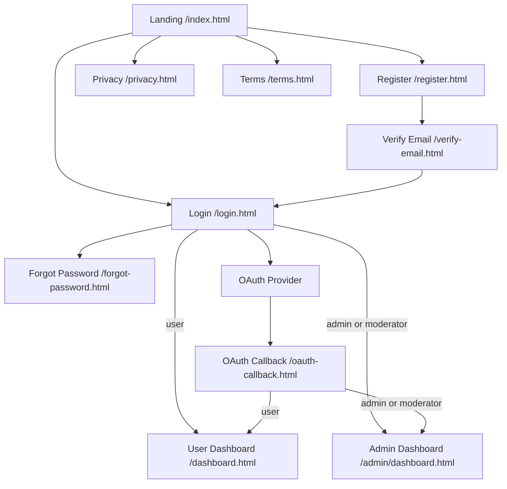
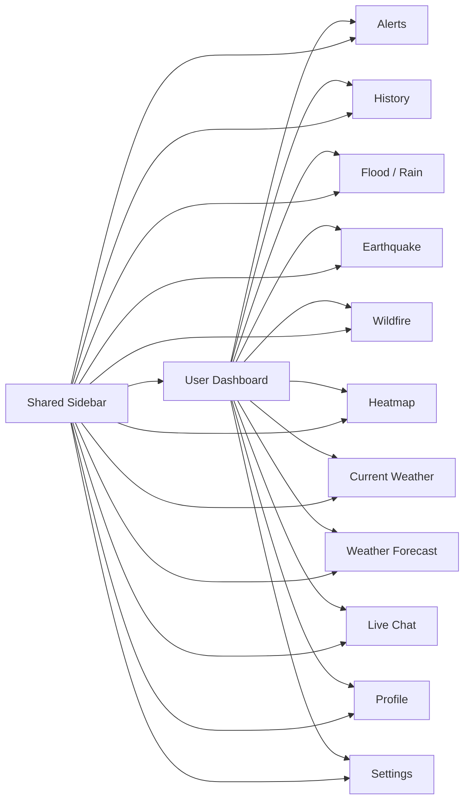

# DisasterGuard — Project Pages Documentation

> Analysis-only document. No existing application code, pages, or components were modified.
> Analysis date: 2026-11-16
> Scope: all HTML pages under `frontend/`, their navigation, roles, components, API usage, and implementation status.

---

## 1. Project Overview

DisasterGuard is an AI-based multi-disaster risk prediction and mapping system for Pakistan.

| Layer | Technology |
|---|---|
| Backend | FastAPI (`backend/main.py`), Python |
| Database | PostgreSQL (`disasterguard`), configurable SQLite fallback |
| Frontend | Static HTML + global CSS + vanilla JavaScript (no framework, no template engine) |
| Maps | Leaflet 1.9.4 + OpenStreetMap/Esri tiles |
| Charts | Chart.js (CDN) |
| Auth | JWT Bearer tokens, bcrypt password hashing, Google/GitHub OAuth |
| AI / Data | Gemini chat service, USGS earthquake feed, OpenWeatherMap, LSTM flood model, earthquake ML model |
| Serving | FastAPI serves `frontend/` statically and exposes `/api/*` |

### Page totals

| Group | Pages |
|---|---:|
| Root / public / auth | 9 |
| Authenticated user application (`frontend/pages/`) | 11 |
| Admin application (`frontend/admin/`) | 9 |
| **Total HTML pages** | **29** |

### Status totals

| Status | Count | Meaning |
|---|---:|---|
| Functional | 12 | Primary flow is wired to a real backend/API |
| Partial | 8 | Real flow exists, but important parts are local-only, simulated, or broken |
| Mock / incomplete | 9 | Primary content is hardcoded, randomized, or backed by missing endpoints |

### Role totals

| Role | Pages |
|---|---:|
| Public / guest (includes auth pages) | 8 |
| Authenticated user (JWT role `user`; admin can also open) | 12 |
| Admin (JWT role `admin`) | 9 |

> The UI references a `moderator` role (admin login accepts it, Admin Settings has moderator forms), but the backend defines no moderator permissions and no moderator-only pages. See Section 5.

---

## 2. Complete Page Inventory

### 2.1 Root, public, and authentication pages

| # | Route | File | Lines | Access | Status |
|---:|---|---|---:|---|---|
| 1 | `/index.html` | `frontend/index.html` | 326 | Public | Functional |
| 2 | `/login.html` | `frontend/login.html` | 229 | Public | Functional |
| 3 | `/register.html` | `frontend/register.html` | 343 | Public | Partial |
| 4 | `/forgot-password.html` | `frontend/forgot-password.html` | 255 | Public | Mock / incomplete |
| 5 | `/verify-email.html` | `frontend/verify-email.html` | 264 | Public | Partial |
| 6 | `/oauth-callback.html` | `frontend/oauth-callback.html` | 186 | Public | Functional |
| 7 | `/privacy.html` | `frontend/privacy.html` | 192 | Public | Functional |
| 8 | `/terms.html` | `frontend/terms.html` | 149 | Public | Functional |
| 9 | `/dashboard.html` | `frontend/dashboard.html` | 954 | User | Functional (two static widgets) |

### 2.2 Authenticated user pages

| # | Route | File | Lines | Access | Status |
|---:|---|---|---:|---|---|
| 10 | `/pages/alerts.html` | `frontend/pages/alerts.html` | 291 | User | Partial |
| 11 | `/pages/history.html` | `frontend/pages/history.html` | 194 | User | Mock / incomplete |
| 12 | `/pages/heatmap.html` | `frontend/pages/heatmap.html` | 323 | User | Mock / incomplete |
| 13 | `/pages/flood.html` | `frontend/pages/flood.html` | 631 | User | Functional |
| 14 | `/pages/earthquake.html` | `frontend/pages/earthquake.html` | 878 | User | Functional |
| 15 | `/pages/wildfire.html` | `frontend/pages/wildfire.html` | 527 | User | Mock / incomplete |
| 16 | `/pages/weather.html` | `frontend/pages/weather.html` | 820 | User | Functional |
| 17 | `/pages/forecast.html` | `frontend/pages/forecast.html` | 691 | User | Partial |
| 18 | `/pages/live-chat.html` | `frontend/pages/live-chat.html` | 463 | User | Functional |
| 19 | `/pages/profile.html` | `frontend/pages/profile.html` | 392 | User | Partial |
| 20 | `/pages/settings.html` | `frontend/pages/settings.html` | 349 | User | Partial |

### 2.3 Admin pages

| # | Route | File | Lines | Access | Status |
|---:|---|---|---:|---|---|
| 21 | `/admin/index.html` | `frontend/admin/index.html` | 31 | Public redirect | Functional (redirect only) |
| 22 | `/admin/admin-login.html` | `frontend/admin/admin-login.html` | 242 | Public | Functional |
| 23 | `/admin/dashboard.html` | `frontend/admin/dashboard.html` | 425 | Admin (intended) | Mock / incomplete |
| 24 | `/admin/users.html` | `frontend/admin/users.html` | 268 | Admin (intended) | Partial |
| 25 | `/admin/models.html` | `frontend/admin/models.html` | 585 | Admin (intended) | Partial |
| 26 | `/admin/logs.html` | `frontend/admin/logs.html` | 150 | Admin (intended) | Mock / incomplete |
| 27 | `/admin/config.html` | `frontend/admin/config.html` | 217 | Admin (intended) | Mock / incomplete |
| 28 | `/admin/api-monitor.html` | `frontend/admin/api-monitor.html` | 394 | Admin (intended) | Mock / incomplete |
| 29 | `/admin/admin-settings.html` | `frontend/admin/admin-settings.html` | 495 | Admin (intended) | Mock / incomplete |

---

## 3. Per-Page Details

### 3.1 Public / authentication

#### 1. Landing Page — `/index.html`
- **Purpose:** Marketing/landing page for DisasterGuard.
- **Sections:** Fixed navbar (Features, Demo, About, Login, Get Started); hero with CTA; feature grid (Flood Prediction, Earthquake Prediction, Wildfire Detection); product demo/preview; "How It Works" (Data Collection, AI Analysis, Risk Assessment, Early Alerts); CTA panel; footer.
- **Components:** Hero buttons, feature cards, footer link columns, Leaflet CSS included but no map instance.
- **Data/API:** None. Fully static content.
- **Actions:** Anchor scroll, links to `register.html` and `login.html`.
- **Status:** Functional as static marketing page.
- **Gaps:** Footer API/About/Contact/Privacy/Social links are `href="#"` stubs even though `privacy.html` exists.

#### 2. Login — `/login.html`
- **Purpose:** User/admin/moderator sign-in.
- **Sections:** Split auth layout; email, password with show/hide toggle, Remember Me, Forgot Password link, submit; Google and GitHub OAuth buttons; "Create account" link.
- **Data/API:** `POST /api/auth/login`; `GET /api/auth/google`; `GET /api/auth/github`.
- **Actions:** Stores `auth_token` and `user_data` via `AuthManager.setAuth`; redirects `admin`/`moderator` to `/admin/dashboard.html`, others to `/dashboard.html`; OAuth redirects to provider URL.
- **Status:** Functional.
- **Gaps / risks:** Remember Me stores the plaintext password in `localStorage` (`saved_password`). OAuth requires provider configuration.

#### 3. Registration — `/register.html`
- **Purpose:** Create a local account and verify email by PIN.
- **Sections:** Registration card (name, email, password, confirm password, terms checkbox), social sign-up, inline PIN verification modal, success toast.
- **Data/API:** `POST /api/auth/register`; `POST /api/auth/verify-pin`; `POST /api/auth/resend-pin` (missing); OAuth endpoints.
- **Actions:** Registration sends email PIN, stores `pending_email`, redirects to `verify-email.html`; modal verifies PIN and then redirects to login.
- **Status:** Partial.
- **Gaps:** The page sends `{ email, password: pin }` but `/api/auth/verify-pin` reads `{ email, pin }`, so PIN verification always fails. Resend endpoint does not exist.

#### 4. Forgot Password — `/forgot-password.html`
- **Purpose:** Password reset request and new-password form.
- **Sections:** Four-step UI: enter email, "email sent" confirmation, new password with live validation rules, success screen; reset-token mode from `?token=`.
- **Data/API:** None. Both submit handlers use `setTimeout` to simulate success.
- **Status:** Mock / incomplete.
- **Gaps:** Backend `POST /api/auth/forgot-password` exists but is never called; no reset-password endpoint; token in URL is accepted without validation.

#### 5. Verify Email — `/verify-email.html`
- **Purpose:** Six-digit PIN verification after registration.
- **Sections:** Email display, six single-digit PIN inputs with auto-advance, verify button, resend button, success panel with redirect.
- **Data/API:** `POST /api/auth/verify-pin`; `POST /api/auth/resend-pin` (missing).
- **Actions:** On success it stores user data and a synthetic token `verified_token_<timestamp>`, then redirects to login/dashboard.
- **Status:** Partial.
- **Gaps:** Sends `password` instead of `pin` to the backend (same mismatch as registration), so verification cannot succeed; success path issues a fake non-JWT token; resend endpoint is missing.

#### 6. OAuth Callback — `/oauth-callback.html`
- **Purpose:** Complete Google/GitHub OAuth login.
- **Sections:** Centered spinner/status panel; error state.
- **Data/API:** Reads `success`, `email`, `name`, `token`, `role` query parameters or calls `GET /api/auth/{provider}/callback?code=...`.
- **Actions:** Stores auth through `AuthManager.setAuth`; redirects admins/moderators to `/admin/dashboard.html`, users to `/dashboard.html`.
- **Status:** Functional.
- **Gaps:** Token passed in query string; provider availability depends on backend env configuration.

#### 7. Privacy Policy — `/privacy.html`
- **Purpose:** Static privacy policy.
- **Sections:** Information collected, usage, storage/security, third parties, cookies, rights, retention, children, changes, contact.
- **Data/API:** None.
- **Status:** Functional static legal page.

#### 8. Terms of Service — `/terms.html`
- **Purpose:** Static terms of service.
- **Sections:** Acceptance, service description, responsibilities, account security, privacy, warranty disclaimer, liability, changes, contact.
- **Data/API:** None.
- **Status:** Functional static legal page.

### 3.2 Authenticated user application

#### 9. User Dashboard — `/dashboard.html`
- **Purpose:** Main situational-awareness dashboard for the signed-in user.
- **Sections:** Location status and city selector with autocomplete/geolocation; Flood risk card; Earthquake risk card; Wildfire risk card; live mini map; recent activity table; notification dropdown; user dropdown.
- **Data/API:**
  - `GET /api/flood-lstm/overview?limit=...`
  - `GET /api/flood-lstm/predict-by-city?live=true&city=...`
  - `GET /api/flood-lstm/cities`
  - `GET /api/earthquake/risk-by-city?city=...&live=true`
  - `GET /api/earthquake/usgs-events?limit=5&minmagnitude=4`
  - `GET /api/weather/autocomplete?query=...`
- **Actions:** Detect GPS/selected location, apply city, refresh all cards, auto-refresh timer, print/export report, logout.
- **Status:** Functional for flood and earthquake data.
- **Gaps:** Wildfire card is hardcoded (score `0.12`, "Low"); "Generate Report" is a 2-second simulated toast; recent activity is derived from the same live calls.

#### 10. Alerts — `/pages/alerts.html`
- **Purpose:** Disaster alert feed for a selected location.
- **Sections:** Alert summary counters (3 / 5 / 12 static), location search/geolocation control, alert feed, mark-all-read, configure-alerts link.
- **Data/API:** `GET /api/weather/current?lat=...&lon=...` from `location.js` (`/api/weather/search`, `/api/weather/current`, `/api/weather/my-location`).
- **Actions:** Search city, use own location, filter static alert cards by city, inject one live weather alert.
- **Status:** Partial.
- **Gaps:** Core alert list and counters are hardcoded; "Mark all read" only shows an alert dialog; no alerts backend endpoint (`/api/alerts/all` does not exist).

#### 11. History — `/pages/history.html`
- **Purpose:** Historical disaster/risk events.
- **Sections:** Header, static data table (Date/Time, Event Type, Location, Severity, Details, Actions) with three sample rows.
- **Data/API:** None.
- **Actions:** Only notification/user dropdown toggles and logout.
- **Status:** Mock / incomplete.
- **Gaps:** No fetch, no date filters, no search, no pagination, no working view/export actions.

#### 12. Heatmap — `/pages/heatmap.html`
- **Purpose:** Geographic risk heatmap across Pakistani cities.
- **Sections:** Leaflet full map, city search, risk legend, layer/filter buttons, popup risk details.
- **Data/API:** None. Uses an inline `cities` array with hardcoded risk scores.
- **Actions:** Render circle markers, layer switch, refresh, focus city from search.
- **Status:** Mock / incomplete.
- **Gaps:** Risk values are static; no `/api/heatmap/data`; "refresh" does not fetch new data.

#### 13. Flood / Rain — `/pages/flood.html`
- **Purpose:** LSTM-based flood risk monitoring and prediction.
- **Sections:** City search/autocomplete, live weather summary, flood risk score and indicators, model card/status, prediction history chart/table, risk overview map, supported city list.
- **Data/API:**
  - `GET /api/flood-lstm/model-info`
  - `GET /api/flood-lstm/overview?limit=50`
  - `GET /api/flood-lstm/history?city=...&limit=30`
  - `GET /api/flood-lstm/predict-by-city?live=true&city=...`
  - `GET /api/flood-lstm/cities`
  - `GET /api/weather/search?city=...`
  - `GET /api/weather/autocomplete?query=...`
- **Actions:** Select city, live predict, refresh, map markers, model status rendering.
- **Status:** Functional end-to-end backend integration.
- **Gaps:** Depends on LSTM model artifacts; gracefully shows unavailable status when missing.

#### 14. Earthquake — `/pages/earthquake.html`
- **Purpose:** Earthquake risk, live USGS events, and model overview.
- **Sections:** City search, risk score card, model info card, live status/last-updated, Leaflet event map, event table/history, overview statistics, charts.
- **Data/API:**
  - `GET /api/earthquake/model-info`
  - `GET /api/earthquake/risk-by-city?city=...&live=true`
  - `GET /api/earthquake/events?limit=...` (optionally by city)
  - `GET /api/earthquake/overview?limit=...`
  - `GET /api/earthquake/usgs-events?limit=...`
  - `GET /api/earthquake/cities`
- **Actions:** City select, refresh, auto-refresh (60s), map markers/popups, event history.
- **Status:** Functional end-to-end backend integration.

#### 15. Wildfire — `/pages/wildfire.html`
- **Purpose:** Satellite fire hotspot monitoring.
- **Sections:** Risk score card with temperature/humidity/wind bars, satellite status, 7-day temperature chart, fire-risk condition cards, "NASA FIRMS" Leaflet map, satellite data-source cards, fire detection history table.
- **Data/API:** None. All values, chart arrays, map markers, and table state are hardcoded.
- **Actions:** Refresh only spins an icon; city search/autocomplete updates the label but does not fetch or recalculate anything.
- **Status:** Mock / incomplete.
- **Gaps:** No wildfire backend endpoint; the map shows four "Safe" city markers; no fire data integration.

#### 16. Current Weather — `/pages/weather.html`
- **Purpose:** Real-time weather across major Pakistani cities.
- **Sections:** Large current-weather card, 8-city grid, full city weather table, city search/autocomplete, refresh.
- **Data/API:** `GET /api/weather/current?lat=...&lon=...` for the top 20 major cities in parallel, and on city selection.
- **Actions:** Load all cities, select/search a city, refresh, update main card.
- **Status:** Functional.
- **Gaps:** Current-weather card hardcodes visibility (`10 km`) and pressure (`1012 hPa`) instead of using the fetched values.

#### 17. Weather Forecast — `/pages/forecast.html`
- **Purpose:** Five-day forecast for a selected city.
- **Sections:** Selected-city hero card, five-day forecast grid, detailed forecast table, city search, refresh.
- **Data/API:** `GET /api/weather/forecast?lat=...&lon=...`.
- **Actions:** Select city, fetch and group 3-hourly data into daily forecasts, render grid/table.
- **Status:** Partial.
- **Gaps:** On API failure or non-200 response it silently generates randomized mock forecasts (`generateMockData`); initial selected-city card may render mock data before the fetch resolves.

#### 18. Live Chat — `/pages/live-chat.html`
- **Purpose:** AI disaster assistant.
- **Sections:** Chat header, message list, quick-prompt chips, input form, clear-chat and export-chat buttons.
- **Data/API:** `POST /api/ai/chat` with `{ message }`.
- **Actions:** Send message, typing indicator, formatted bot reply, quick prompts, clear chat, export transcript.
- **Status:** Functional.
- **Gaps:** Chat history is cleared on every page load; no streaming; depends on Gemini API key/backend service.

#### 19. Profile — `/pages/profile.html`
- **Purpose:** User profile and account security.
- **Sections:** Profile header/avatar, personal information form (first/last name, email, phone, location), security buttons (Change Password, Enable 2FA), activity summary (alerts, reports, member since).
- **Data/API:** None. Reads/writes `localStorage` only.
- **Actions:** Save profile locally, change password via `prompt()`, toggle 2FA locally, logout.
- **Status:** Partial.
- **Gaps:** Profile updates never reach the backend; password change is simulated (`passwordChanged` flag); 2FA is a local flag only; activity counts are partly random.

#### 20. Settings — `/pages/settings.html`
- **Purpose:** Notification preferences and saved locations.
- **Sections:** Notification preference checkboxes (email, push, SMS, critical-only); Add Location with autocomplete; save-as-default checkbox; saved locations list with set-default and "show more"; default-location conflict modal.
- **Data/API:**
  - `GET /api/weather/autocomplete?query=...`
  - `GET /api/weather/search?city=...`
  - `POST /api/auth/update-location`
- **Actions:** Add/search a location, persist saved/default locations in `localStorage`, sync city to backend, show conflict modal, save preferences.
- **Status:** Partial.
- **Gaps:** Notification checkboxes are never read or persisted; "Save Changes" only shows an alert; GPS coordinates are not saved to the backend (city name only).

### 3.3 Admin application

#### 21. Admin Redirect — `/admin/index.html`
- **Purpose:** Splash/redirect to admin login.
- **Sections:** None; meta refresh and script redirect.
- **Actions:** Clears `localStorage` and `sessionStorage`, then replaces location with `/admin/admin-login.html`.
- **Status:** Functional redirect only.
- **Gaps:** Contains stray dead JavaScript inside the `<title>`/body; clearing all storage can destroy an existing admin session if this URL is opened directly.

#### 22. Admin Login — `/admin/admin-login.html`
- **Purpose:** Admin/moderator portal login.
- **Sections:** Admin-branded auth card, email/password, show/hide password, Remember Me, forgot-password contact prompt, back-to-user-login link.
- **Data/API:** `POST /api/auth/login`.
- **Actions:** Verifies `role` is `admin` or `moderator`; stores token/user data; optionally remembers admin email; redirects to admin dashboard.
- **Status:** Functional.
- **Gaps:** "Remember Me" stores email only (acceptable); no server-side admin session hardening; users with `moderator` can enter but have no defined backend permissions.

#### 23. Admin Dashboard — `/admin/dashboard.html`
- **Purpose:** Admin system overview.
- **Sections:** System-online badge; four stat cards (users, API calls, uptime, model version); API usage chart; API health cards; recent registrations table; model status; system logs panel; admin sidebar/user menu.
- **Data/API:** None. Stats, chart arrays, health text, registrations, model status, and logs are hardcoded.
- **Actions:** Debug-mode alert, dropdowns, logout.
- **Status:** Mock / incomplete.
- **Gaps:** No auth guard; does not load `main.js`; no data fetches; "1,247 users", "8.5K API calls", "99.9%" are static.

#### 24. Admin Users — `/admin/users.html`
- **Purpose:** User management list.
- **Sections:** Search, users table (avatar/name, email, provider, IP, role, joined, last active, status, actions), loading/error/empty states.
- **Data/API:** `GET /api/admin/users?page=...&search=...` with `Authorization: Bearer <token>`.
- **Actions:** Load/search users, render roles/status, Edit.
- **Status:** Partial.
- **Gaps:** Edit navigates to non-existent `/admin/edit-user.html`; no pagination controls; no create/delete UI; backend `/api/admin/users` does not enforce `admin_only`; admin pages have no client-side guard.

#### 25. Admin Models — `/admin/models.html`
- **Purpose:** Model management and monitoring.
- **Sections:** Model cards (earthquake, flood, wildfire), accuracy/usage charts, recent training jobs, deploy-model modal, "New Training" action.
- **Data/API:** `GET /api/earthquake/model-info`; `GET /api/flood-lstm/model-info`.
- **Actions:** Load real model versions/metrics, refresh cards, open/cancel deploy modal, start training, refresh all.
- **Status:** Partial.
- **Gaps:** Accuracy trends, usage shares, and training jobs are randomized; deploy/train actions only show toasts; wildfire model card is static.

#### 26. Admin Logs — `/admin/logs.html`
- **Purpose:** System log viewer.
- **Sections:** Log toolbar (refresh, export), console-style log container.
- **Data/API:** None. Generates 50 random `INFO/WARN/ERROR/DEBUG` lines every 10 seconds.
- **Actions:** Refresh, export (alert only).
- **Status:** Mock / incomplete.
- **Gaps:** No real log endpoint, no filtering, no download; `exportLogs` is fake.

#### 27. Admin Alert Config — `/admin/config.html`
- **Purpose:** Configure alert thresholds and delivery.
- **Sections:** Alert threshold inputs, notification channel toggles, scheduling, API/security settings, Save Changes.
- **Data/API:** None.
- **Actions:** `saveConfig()` only shows "Configuration saved (would persist in production)".
- **Status:** Mock / incomplete.
- **Gaps:** No persistence, no backend endpoint, no validation.

#### 28. Admin API Monitor — `/admin/api-monitor.html`
- **Purpose:** External API health and request monitoring.
- **Sections:** Overall status, average latency, API cards (USGS, NASA, OpenWeather, GDACS), latency chart, distribution doughnut, recent API-call table.
- **Data/API:** None. All latencies, request counts, status codes, chart data, and log rows are randomized; auto-refreshes every 5 seconds.
- **Actions:** Refresh all, dropdowns, logout.
- **Status:** Mock / incomplete.
- **Gaps:** Fake monitoring; listed endpoints include non-existent `/api/wildfire/active`, `/api/alerts/all`, `/api/risk/assessment`, `/api/heatmap/data`, `/api/earthquake/recent`, `/api/flood/predict`.

#### 29. Admin Settings — `/admin/admin-settings.html`
- **Purpose:** Admin password and moderator management.
- **Sections:** Change Password form; Add Moderator form; Existing Moderators table; Role Permissions matrix; admin sidebar.
- **Data/API:**
  - `POST /api/admin/change-password` (missing)
  - `POST /api/admin/add-moderator` (missing)
  - `DELETE /api/admin/remove-moderator/{id}` (missing)
  - `GET /api/admin/moderators` (missing)
- **Actions:** Submit forms, remove moderator, load moderator list.
- **Status:** Mock / incomplete.
- **Gaps:** All four endpoints are absent, so every action fails; table starts with hardcoded rows; no admin guard.

---

## 4. Role Structure

### 4.1 Roles in the data model and UI

| Role | Source | Intended access |
|---|---|---|
| Guest | No token | Landing, login, register, forgot password, verify email, OAuth callback, legal pages |
| `user` | JWT `role` claim / DB `users.role` | User dashboard and all `/pages/*` pages |
| `moderator` | Referenced in UI and role matrix | Admin login accepts it; no backend permissions, no dedicated pages, no moderator checks |
| `admin` | JWT/DB role | Admin pages, user pages, `admin_only`-protected admin endpoints |

### 4.2 Actual enforcement

- Backend `get_current_user` validates the JWT and loads the user from the DB.
- `admin_only` exists and is used only on `GET /api/admin/users/{id}`, `PUT /api/admin/users/{id}`, and `DELETE /api/admin/users/{id}`.
- `GET /api/admin/users` (the endpoint used by the admin users page) is **unprotected**.
- No `moderator_only` dependency exists.
- User pages call `AuthManager.requireAuth()`; admin pages do **not** call `AuthManager.requireAdmin()` or `checkAdminAuth()`.
- Admin page access is therefore only protected by knowing the URL and by the admin-login flow; direct visits are not blocked client-side.

### 4.3 Role permissions matrix shown in Admin Settings

| Capability | Admin | Moderator | User |
|---|---|---|---|
| View user dashboard | Yes | Yes (UI) | Yes |
| View disaster monitoring pages | Yes | Yes (UI) | Yes |
| Manage users | Yes (UI) | No | No |
| Manage models | Yes (UI) | No | No |
| Configure alerts | Yes (UI) | No | No |
| View audit/system logs | Yes (UI) | No | No |
| Manage moderators | Yes (UI) | No | No |
| Change own password | Yes (UI, broken) | No | Profile only (broken) |

---

## 5. Navigation Flow

### 5.1 Public and authentication flow



### 5.2 Authenticated user navigation



### 5.3 Admin navigation

```mermaid
flowchart LR
    AINDEX[/admin/index.html] --> ALOGIN[Admin Login]
    ALOGIN --> ADASH[Admin Dashboard]
    ADASH --> AUSERS[User Management]
    ADASH --> AMON[API Monitor]
    ADASH --> AMODELS[Model Management]
    ADASH --> ACONFIG[Alert Config]
    ADASH --> ALOGS[Audit / System Logs]
    ADASH --> ASET[Admin Settings]
    ADASH --> UVIEW[User View]
    AUSERS --> EDIT[Missing edit-user.html]
```

> The user sidebar and admin sidebar are duplicated inline in every page, not shared through includes.

---

## 6. Shared Components and Frontend Utilities

### 6.1 Global CSS components (`frontend/css/styles.css`)

| Component | Classes / usage |
|---|---|
| Background | `.bg-mesh`, `.bg-grid` |
| Navigation | `.navbar`, `.navbar-content`, `.logo`, `.notif-btn`, `.notif-badge` |
| Sidebar | `.sidebar`, `.sidebar-section`, `.sidebar-title`, `.sidebar-menu` |
| Cards | `.card-3d`, `.stat-card`, `.stat-value`, `.stat-label`, `.mirror-effect` |
| Risks | `.risk-badge` (`low`, `moderate`, `high`, `critical`, `extreme`), `.risk-score`, `.risk-bar-fill` |
| Tables | `.data-table`, responsive wrapper injected by `mobile-nav.js` |
| Forms | `.input-field`, `.input-group`, `.password-toggle`, `.btn`, `.btn-primary`, `.btn-secondary` |
| Dropdowns | `.dropdown-menu`, `.dropdown-header`, `.dropdown-list`, `.dropdown-item`, `.dropdown-divider` |
| Status | `.status-badge` (`active`, `inactive`, `critical`) |
| Auth | `.auth-card`, `.auth-container`, split-screen layouts |
| Feedback | `.toast`, `.toast-success`, `.toast-error`, `.toast-info`, loading spinners |
| Map/chart | Leaflet containers (`#miniMap`, `#riskMap`, `#fireMap`), Chart.js canvases |
| Mobile | Hamburger button, backdrop, off-canvas sidebar, scrollable tables |

### 6.2 JavaScript utilities (`frontend/js/main.js`)

| Class | Responsibility |
|---|---|
| `Toast` | Temporary toast notifications |
| `APIManager` | Base `/api` URL, auth headers (`static getHeaders` and instance method) |
| `AuthManager` | `isAuthenticated`, `getUser`, `isAdminOrModerator`, `requireAuth`, `checkAdminAuth`, `requireAdmin`, `setAuth`, `loadUserName`, `logout` |
| `ChartManager` | Risk chart creation/update |
| `MapManager` | Leaflet init, markers, risk zones, clear |
| `RiskCalculator` | Flood/earthquake/wildfire risk formulas and labels |
| `DataManager` | `localStorage` helpers |
| `Validator` | Email/password/phone/required validation |
| Animation helpers | Fade, slide, pulse |
| `format` / `timeAgo` | Date formatting |

### 6.3 Other shared scripts

| File | Responsibility |
|---|---|
| `frontend/js/api-config.js` | Rewrites `fetch` to the backend origin when the frontend is served statically on a different port; adds cache-busting behavior |
| `frontend/js/location.js` | `DisasterLocation` API: GPS detection, IP fallback, weather reverse-geocode, city search, selected/cached location |
| `frontend/js/mobile-nav.js` | Hamburger/off-canvas sidebar, backdrop, Escape/resize handling, automatic table wrappers and `MutationObserver` |
| CDN dependencies | Chart.js, Leaflet 1.9.4, Font Awesome 6.4, Google Fonts (Inter) |

### 6.4 Duplicated patterns to consolidate during redesign

- Navbar and sidebar markup repeated on every authenticated page.
- User dropdown and notification dropdown repeated on every page.
- City search/autocomplete implemented separately in dashboard, alerts, flood, earthquake, heatmap, weather, forecast, wildfire, settings.
- Map setup repeated in dashboard, heatmap, wildfire, earthquake, flood.
- Auth guard block repeated in 13 user pages.
- Inline `style="..."` attributes heavily used instead of reusable classes.

---

## 7. API and Backend Dependencies

### 7.1 Real backend endpoint inventory

| Prefix | Method and path | Purpose | Auth |
|---|---|---|---|
| `/api/auth` | `POST /login` | Email/password login, returns JWT | Public |
| `/api/auth` | `POST /register` | Create user, generate/send PIN | Public |
| `/api/auth` | `POST /verify-pin` | Verify email PIN (`pin` field) | Public |
| `/api/auth` | `POST /forgot-password` | Generate/send reset PIN | Public |
| `/api/auth` | `POST /update-location` | Save user's city | Public (email-based) |
| `/api/auth` | `GET /google`, `GET /google/callback` | Google OAuth | Public |
| `/api/auth` | `GET /github`, `GET /github/callback` | GitHub OAuth | Public |
| `/api/weather` | `GET /current` | Current weather by lat/lon | Public |
| `/api/weather` | `GET /forecast` | 5-day / 3-hour forecast | Public |
| `/api/weather` | `GET /my-location` | IP-based location | Public |
| `/api/weather` | `GET /search` | City geocoding/search | Public |
| `/api/weather` | `GET /autocomplete` | City autocomplete | Public |
| `/api/weather` | `GET /pakistan-cities` | City list | Public |
| `/api/weather` | `GET /api-key` | Weather API key/config info | Public |
| `/api/ai` | `POST /chat` | Gemini chat response | Public |
| `/api/earthquake` | `GET /model-info` | Model metadata/metrics | Public |
| `/api/earthquake` | `POST /predict` | Earthquake prediction | Public |
| `/api/earthquake` | `GET /risk-by-city` | Risk for a city (live option) | Public |
| `/api/earthquake` | `GET /events` | Stored earthquake events | Public |
| `/api/earthquake` | `GET /cities` | Supported cities | Public |
| `/api/earthquake` | `GET /overview` | Aggregated event overview | Public |
| `/api/earthquake` | `GET /usgs-events` | Live USGS feed | Public |
| `/api/flood-lstm` | `GET /model-info` | LSTM metadata/artifacts | Public |
| `/api/flood-lstm` | `GET /cities` | Supported cities | Public |
| `/api/flood-lstm` | `GET /history` | Prediction history by city | Public |
| `/api/flood-lstm` | `GET /overview` | Risk overview for map/list | Public |
| `/api/flood-lstm` | `POST /predict` | Flood prediction | Public |
| `/api/flood-lstm` | `GET /predict-by-city` | City prediction (live option) | Public |
| `/api/admin` | `GET /users` | Paginated user list/search | **None** |
| `/api/admin` | `GET /users/{id}` | Single user | `admin_only` |
| `/api/admin` | `PUT /users/{id}` | Update user | `admin_only` |
| `/api/admin` | `DELETE /users/{id}` | Delete user | `admin_only` |

### 7.2 Page-to-API matrix

| Page | Endpoints used |
|---|---|
| Landing | None |
| Login | `POST /api/auth/login`, `GET /api/auth/google`, `GET /api/auth/github` |
| Register | `POST /api/auth/register`, `POST /api/auth/verify-pin`, `POST /api/auth/resend-pin` (missing), OAuth |
| Forgot Password | None (backend `/api/auth/forgot-password` unused) |
| Verify Email | `POST /api/auth/verify-pin`, `POST /api/auth/resend-pin` (missing) |
| OAuth Callback | `GET /api/auth/{provider}/callback` |
| User Dashboard | `GET /api/flood-lstm/overview`, `/predict-by-city`, `/cities`; `GET /api/earthquake/risk-by-city`, `/usgs-events`; `GET /api/weather/autocomplete` |
| Alerts | `GET /api/weather/current` (plus `location.js`) |
| History | None |
| Heatmap | None |
| Flood | `GET /api/flood-lstm/model-info`, `/overview`, `/history`, `/predict-by-city`, `/cities`; `GET /api/weather/search`, `/autocomplete` |
| Earthquake | `GET /api/earthquake/model-info`, `/risk-by-city`, `/events`, `/overview`, `/usgs-events`, `/cities` |
| Wildfire | None |
| Weather | `GET /api/weather/current` |
| Forecast | `GET /api/weather/forecast` |
| Live Chat | `POST /api/ai/chat` |
| Profile | None (localStorage only) |
| Settings | `GET /api/weather/autocomplete`, `GET /api/weather/search`, `POST /api/auth/update-location` |
| Admin Redirect | None |
| Admin Login | `POST /api/auth/login` |
| Admin Dashboard | None |
| Admin Users | `GET /api/admin/users` |
| Admin Models | `GET /api/earthquake/model-info`, `GET /api/flood-lstm/model-info` |
| Admin Logs | None |
| Admin Config | None |
| Admin API Monitor | None |
| Admin Settings | `POST /api/admin/change-password`, `POST /api/admin/add-moderator`, `DELETE /api/admin/remove-moderator/{id}`, `GET /api/admin/moderators` (all missing) |

### 7.3 Endpoints referenced by the frontend but not implemented

| Missing endpoint | Consumer |
|---|---|
| `POST /api/auth/resend-pin` | Register, Verify Email |
| `POST /api/auth/reset-password` | Not called; needed to complete Forgot Password |
| `POST /api/admin/change-password` | Admin Settings |
| `POST /api/admin/add-moderator` | Admin Settings |
| `DELETE /api/admin/remove-moderator/{id}` | Admin Settings |
| `GET /api/admin/moderators` | Admin Settings |
| `GET /api/earthquake/recent` | Admin API Monitor log labels |
| `GET /api/wildfire/active` | Admin API Monitor; no wildfire backend exists |
| `POST /api/flood/predict` | Admin API Monitor (real path is `/api/flood-lstm/predict`) |
| `GET /api/alerts/all` | Admin API Monitor; alerts feed is static |
| `GET /api/risk/assessment` | Admin API Monitor |
| `GET /api/heatmap/data` | Admin API Monitor; heatmap is static |

### 7.4 Backend/API issues affecting pages

1. **PIN field mismatch:** frontend sends `password`, backend expects `pin` in `/api/auth/verify-pin`, so registration and email verification cannot complete.
2. **Fake post-verification token:** `verify-email.html` stores `verified_token_<timestamp>` instead of the JWT returned by login.
3. **Plaintext remembered password:** `login.html` stores `saved_password` in `localStorage`.
4. **Unprotected admin user list:** `GET /api/admin/users` has no `admin_only` dependency.
5. **No admin client-side guard:** admin pages can be opened directly; only API calls (partially) enforce roles.
6. **No moderator authorization:** `moderator` is accepted at login but has no backend permission model.
7. **Reset flow incomplete:** no reset-password endpoint and no page-to-backend call in Forgot Password.
8. **Admin index clears sessions:** visiting `/admin/index.html` wipes all local/session storage.

---

## 8. Missing and Incomplete Functionality

### 8.1 By severity

| Area | Issue | Affected pages |
|---|---|---|
| Auth | PIN verification payload mismatch | Register, Verify Email |
| Auth | Forgot/reset password fully simulated | Forgot Password |
| Auth | Fake JWT after email verification | Verify Email |
| Auth | Remember Me stores plaintext password | Login |
| Security | Admin user list endpoint unprotected | Admin Users |
| Security | No admin page auth guard | All 9 admin pages |
| Missing page | `edit-user.html` referenced but absent | Admin Users |
| Wildfire | No backend integration; everything hardcoded | Wildfire, Dashboard wildfire card, Admin API Monitor |
| Heatmap | Static risk dataset; no API | Heatmap |
| History | Static table; no query/export | History |
| Alerts | Static feed/counters; only weather is live | Alerts |
| Reports | Report/export/save actions are toasts | Dashboard, Admin Logs, Admin Config |
| Profile | Edits, password, 2FA are localStorage-only | Profile |
| Settings | Notification preferences not persisted | Settings |
| Forecast | Randomized mock fallback | Forecast |
| Admin dashboard | All statistics/charts/tables static | Admin Dashboard |
| Admin monitoring | Random latency/logs/charts | Admin API Monitor, Admin Logs |
| Admin models | Real model info plus random metrics/jobs | Admin Models |
| Admin settings | All moderator/password endpoints missing | Admin Settings |
| Consistency | Inline styles and duplicated layout across 29 files | Entire frontend |
| Links | Landing footer privacy/API/about/contact/social links are `#` | Landing |

### 8.2 Pages with no backend dependency at all

- History
- Heatmap
- Wildfire
- Profile (localStorage only)
- Admin Dashboard
- Admin Logs
- Admin Config
- Admin API Monitor

### 8.3 Pages whose primary backend dependency is missing

- Admin Settings (all actions)

### 8.4 Pages whose primary backend dependency is broken

- Register (PIN)
- Verify Email (PIN + fake token)
- Forgot Password (no API call)

---

## 9. Stitch Redesign Checklist

> Not started. The lists below define the future page-by-page redesign scope while preserving routes, API calls, auth, and business logic.

### 9.1 Preparation

- [ ] Collect and review every provided Google Stitch design screen.
- [ ] Map each design screen to one of the 29 routes in this document.
- [ ] Identify designs with no existing page (for example an edit-user screen) and confirm whether new pages are required.
- [ ] Confirm the Stitch design source; no Stitch design files were found in the repository during analysis.
- [ ] Confirm role variants (user, moderator, admin) for each redesigned screen.

### 9.2 Design system and shared shell

- [ ] Rebuild navbar, sidebar, user dropdown, notification dropdown, cards, tables, badges, buttons, forms, modals, toasts, and map panels from the designs.
- [ ] Extract repeated inline styles into reusable classes/components.
- [ ] Keep `mobile-nav.js` behavior or replace it with an equivalent responsive implementation.
- [ ] Preserve `AuthManager`, `APIManager`, `DisasterLocation`, chart, and map integrations.
- [ ] Preserve backend origin rewriting in `api-config.js`.

### 9.3 Public and auth pages

- [ ] `/index.html` — landing page.
- [ ] `/login.html` — login, OAuth buttons, remember me.
- [ ] `/register.html` — registration and PIN modal.
- [ ] `/forgot-password.html` — reset flow.
- [ ] `/verify-email.html` — PIN verification.
- [ ] `/oauth-callback.html` — OAuth completion.
- [ ] `/privacy.html` — privacy policy.
- [ ] `/terms.html` — terms.

### 9.4 User application pages

- [ ] `/dashboard.html` — main dashboard.
- [ ] `/pages/flood.html` — flood monitoring.
- [ ] `/pages/earthquake.html` — earthquake monitoring.
- [ ] `/pages/weather.html` — current weather.
- [ ] `/pages/forecast.html` — forecast.
- [ ] `/pages/alerts.html` — alerts.
- [ ] `/pages/wildfire.html` — wildfire.
- [ ] `/pages/heatmap.html` — heatmap.
- [ ] `/pages/history.html` — history.
- [ ] `/pages/live-chat.html` — AI chat.
- [ ] `/pages/profile.html` — profile.
- [ ] `/pages/settings.html` — settings.

### 9.5 Admin pages

- [ ] `/admin/admin-login.html` — admin login.
- [ ] `/admin/dashboard.html` — admin dashboard.
- [ ] `/admin/users.html` — user management.
- [ ] `/admin/models.html` — model management.
- [ ] `/admin/config.html` — alert configuration.
- [ ] `/admin/logs.html` — system logs.
- [ ] `/admin/api-monitor.html` — API monitor.
- [ ] `/admin/admin-settings.html` — admin settings.
- [ ] `/admin/index.html` — redirect behavior (may remain non-visual).

### 9.6 Preservation rules during implementation

- [ ] Keep every existing route and relative link working.
- [ ] Keep all live API calls and their query parameters.
- [ ] Keep JWT storage keys: `auth_token`, `user_data`, and existing admin keys.
- [ ] Keep role-based redirects for `admin`, `moderator`, and `user`.
- [ ] Keep geolocation, search, autocomplete, map, and chart behavior.
- [ ] Do not replace live data with hardcoded values.
- [ ] Do not remove working backend integrations for visual parity.
- [ ] Keep desktop, tablet, and mobile layouts functional after every page.
- [ ] Verify each page's buttons, forms, dropdowns, navigation, and logout.
- [ ] Report completed pages and remaining pages after each implementation batch.

### 9.7 Verification checklist per page

- [ ] Page loads without console errors.
- [ ] Auth guard behaves as intended.
- [ ] All API requests return expected data or a handled error state.
- [ ] All links navigate to existing routes.
- [ ] No horizontal overflow at desktop, tablet, and mobile widths.
- [ ] Loading, empty, error, and success states are present.
- [ ] Visual result matches the provided design.
- [ ] Existing backend/database logic remains untouched.

---

## 10. Key File References

| Purpose | File |
|---|---|
| Backend entry point / static serving | `backend/main.py` |
| Auth and PIN logic | `backend/routes/auth.py`, `backend/utils/security.py`, `backend/utils/dependencies.py` |
| Admin API | `backend/routes/admin.py` |
| Weather API | `backend/routes/weather.py`, `backend/services/weather_service.py` |
| Earthquake API / model | `backend/routes/earthquake.py`, `backend/services/earthquake_service.py`, `backend/services/usgs_earthquake_service.py` |
| Flood LSTM API | `backend/routes/flood_lstm.py`, `backend/services/flood_lstm_service.py` |
| AI chat | `backend/routes/ai.py`, `backend/services/gemini_service.py` |
| OAuth | `backend/routes/auth.py`, `backend/services/oauth_service.py` |
| Email/PIN delivery | `backend/services/email_service.py` |
| DB configuration | `backend/database/db_config.py` |
| User DB operations | `backend/database/db_users.py` |
| Shared frontend utilities | `frontend/js/main.js`, `frontend/js/api-config.js`, `frontend/js/location.js`, `frontend/js/mobile-nav.js` |
| Global styles | `frontend/css/styles.css` |
| Backend tests | `backend/tests/` |
