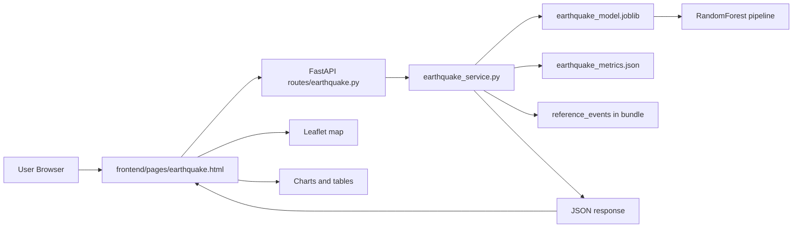
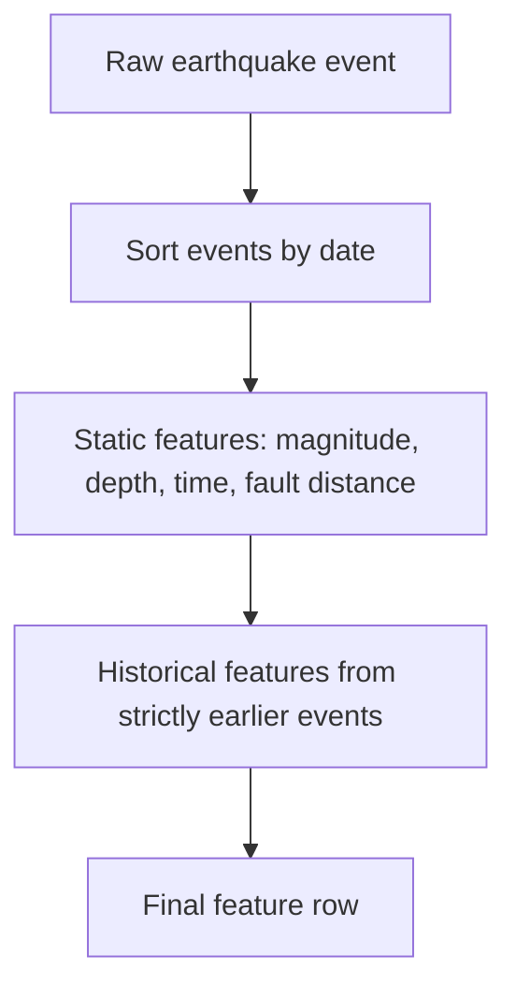
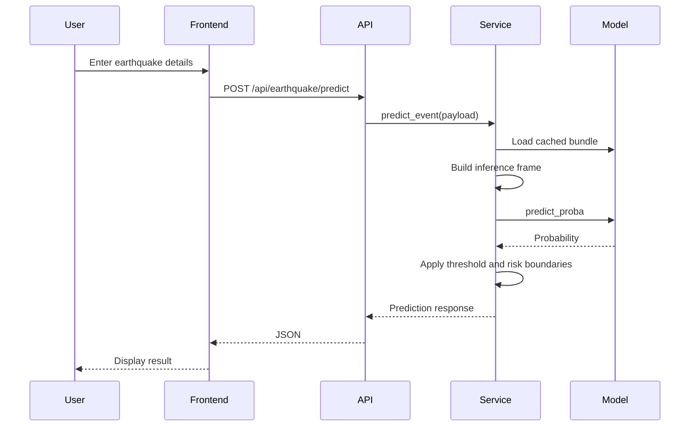

# Earthquake Module Documentation — DisasterGuard

## 1. Introduction

The Earthquake module predicts whether an earthquake event is likely to cause **reported damage** in Pakistan.

It is a binary classification module inside DisasterGuard:

- `damage_occurred = 0` → no reported damage
- `damage_occurred = 1` → damage reported

Main capabilities:

- Predict damage probability for a submitted earthquake event.
- Generate a 0–100 risk score.
- Assign a risk level (`low`, `moderate`, `high`, `extreme`).
- Return contributing factors.
- Return historical seismic context.
- Provide city-level risk scenarios.
- List historical earthquake events.
- Expose model metadata and metrics through an API.
- Display results in the DisasterGuard frontend and admin dashboard.

This module is a **damage-risk prototype**, not a scientifically validated earthquake early-warning system.

---

## 2. System Architecture



Request flow:

1. The user enters earthquake information in the frontend.
2. The frontend sends an HTTP request to FastAPI.
3. The route validates the request with Pydantic.
4. The service loads the cached model bundle.
5. Feature engineering creates the model input row.
6. The RandomForest pipeline predicts damage probability.
7. The deployment threshold and risk boundaries are applied.
8. The API returns probability, risk score, risk level, factors, and context.
9. The frontend displays the result and updates maps/charts.

---

## 3. Technology Stack

- Python 3.11.0
- FastAPI 0.109.0
- scikit-learn 1.4.0
- pandas 2.2.0
- numpy 1.26.3
- joblib 1.3.2
- xgboost 2.0.3 (installed in environment; not used by the Earthquake model)
- PostgreSQL (used by the general DisasterGuard application; the Earthquake module itself uses model artifacts and reference event data)
- Frontend: HTML, CSS, JavaScript, Leaflet

The Earthquake model uses only `RandomForestClassifier`.

---

## 4. Dataset Description

- File: `datasets/pakistan_earthquake_2020_2025.csv`
- Records: 643
- Columns: 9
- Date range: 2020-01-01 to 2025-12-30
- Target: `damage_occurred`
- Positive class: 30 (4.67%)
- Negative class: 613 (95.33%)

Columns:

| Column | Meaning |
| --- | --- |
| `date` | Event date |
| `latitude` | Epicentre latitude |
| `longitude` | Epicentre longitude |
| `magnitude` | Local/Richter magnitude |
| `depth_km` | Hypocentre depth |
| `city` | Associated city |
| `province` | Province or region |
| `damage_occurred` | Target label |
| `deaths` | Reported deaths |

`deaths` is excluded from modeling because it is an outcome of the same event and would leak the target.

Province distribution:

| Province | Events | Damaging events |
| --- | ---: | ---: |
| Balochistan | 213 | 16 |
| AJK | 117 | 8 |
| KPK | 117 | 1 |
| GB | 73 | 1 |
| Punjab | 64 | 0 |
| ICT | 59 | 0 |

Dataset limitations:

- Small dataset.
- Only 30 positive examples.
- Near-deterministic labels based mostly on magnitude and depth.
- Geographic imbalance.
- Missing physical and exposure features.

---

## 5. Feature Engineering

The module uses three candidate feature sets:

- `raw`: latitude, longitude, magnitude, depth, province, city
- `static`: raw plus engineered physical and time features
- `context`: static plus historical seismicity features

The selected feature set is `context`, with 26 feature columns:

1. latitude
2. longitude
3. magnitude
4. depth_km
5. magnitude_squared
6. is_shallow
7. is_very_shallow
8. mag_depth_ratio
9. month_sin
10. month_cos
11. doy_sin
12. doy_cos
13. fault_distance_km
14. near_fault
15. prior_count_7d
16. prior_count_30d
17. prior_count_90d
18. prior_max_mag_30d
19. prior_max_mag_90d
20. prior_mean_depth_30d
21. prior_count_100km_90d
22. min_distance_past_km
23. days_since_previous
24. distance_to_previous_km
25. province
26. city

Historical context features use only events with strictly earlier dates. Same-day events are excluded. No target-derived historical feature is used.

`deaths` and `damage_occurred` are excluded from prediction features.



---

## 6. Machine Learning Model

The model is `RandomForestClassifier` only.

Configuration:

- `class_weight="balanced_subsample"`
- `random_state=42`
- `n_jobs=-1`

Best tuned parameters:

- `n_estimators = 300`
- `max_depth = None`
- `min_samples_leaf = 1`
- `max_features = 0.5`

Training process:

1. Chronological 80/20 split: 514 training rows, 129 holdout rows.
2. Feature-set comparison using 5-fold stratified CV on training data.
3. Hyperparameter tuning using `GridSearchCV` with `average_precision`.
4. Out-of-fold threshold search on training data.
5. Repeated stratified CV.
6. Temporal validation with `TimeSeriesSplit`.
7. Final holdout evaluation on the untouched 129 rows.
8. No refit on all 643 rows; deployment model is trained on the first 80%.

Model version: `3.0.0`

Deployment threshold: `0.19`

The threshold is derived from out-of-fold F2 optimization on training data only.

---

## 7. Model Evaluation and Results

Holdout results (129 rows, 6 positives):

| Metric | Value |
| --- | ---: |
| Accuracy | 1.0000 |
| Balanced accuracy | 1.0000 |
| Precision | 1.0000 |
| Recall | 1.0000 |
| F1-score | 1.0000 |
| ROC-AUC | 1.0000 |
| PR-AUC | 1.0000 |
| Confusion matrix | TN 123, FP 0, FN 0, TP 6 |

Repeated CV (training partition):

- PR-AUC: 0.9824 ± 0.0237
- Precision: 0.9071
- Recall: 0.8767
- F1: 0.8756

Temporal CV:

- PR-AUC: 0.9394
- Precision: 0.8667
- Recall: 0.7833
- F1: 0.8190

Limitations:

- Only 30 positive cases in the full dataset.
- Only 6 positive cases in the holdout.
- Perfect holdout metrics are not sufficient evidence of real-world reliability.
- The model is a prototype, not a validated early-warning system.

---

## 8. Risk Classification

Risk score:

```text
risk_score = round(probability * 100)
```

Risk boundaries:

| Probability | Risk level |
| --- | --- |
| < 0.25 | low |
| 0.25 to < 0.50 | moderate |
| 0.50 to < 0.75 | high |
| ≥ 0.75 | extreme |

Binary prediction:

```text
damage_predicted = probability >= 0.19
```

Risk level and binary prediction are distinct outputs. A probability below 0.25 can still produce `damage_predicted = true` because the deployment threshold is 0.19.

---

## 9. Backend Implementation

Key files:

- `backend/services/earthquake_service.py`
- `backend/routes/earthquake.py`
- `backend/models/disaster_models.py`

Service responsibilities:

- Load and cache the model bundle.
- Load threshold and risk boundaries from metadata.
- Build inference features.
- Run prediction.
- Build factors and historical context.
- Provide model information.
- Handle city-level risk scenarios.
- Return historical events.

Model loading:

- The bundle is loaded once and cached in `_bundle`.
- Startup preloading is configured in `backend/main.py`.
- Missing artifacts raise `FileNotFoundError`.

Input validation:

- `EarthquakePredictRequest` validates magnitude, depth, latitude, and longitude ranges.
- Unknown cities and provinces are handled safely.

Error handling:

- Missing model returns HTTP 503.
- Invalid input returns HTTP 422.
- Other prediction errors return HTTP 400.

Logging:

- Service logger: `disasterguard.earthquake`
- Model load success/failure is logged.

---

## 10. API Documentation

### POST `/api/earthquake/predict`

Predicts damage risk for one earthquake event.

Request body:

```json
{
  "magnitude": 5.8,
  "depth_km": 12.9,
  "latitude": 30.0,
  "longitude": 67.0,
  "province": "Balochistan",
  "city": "Harnai",
  "date": "2025-03-03"
}
```

Response includes:

- model name, version, feature set, threshold
- damage probability
- damage prediction
- risk score
- risk level
- confidence band
- threshold used
- factors
- historical context
- event details

Status codes:

- 200: success
- 400: prediction error
- 422: invalid input
- 503: model unavailable

### GET `/api/earthquake/risk-by-city?city=...`

Returns a city-level scenario prediction, recent events, and location metadata.

Status codes:

- 200: success
- 400: error
- 503: model unavailable

### GET `/api/earthquake/events?city=...&limit=...`

Returns historical earthquake events and summary statistics.

Status codes:

- 200: success
- 503: model unavailable

### GET `/api/earthquake/model-info`

Returns model metadata, dataset information, metrics, feature comparison, CV results, tuning results, training counts, and top features.

Status codes:

- 200: success
- 503: model unavailable

### GET `/health`

Returns:

```json
{"status": "ok"}
```

### GET `/ready`

Returns readiness status, model version, and deployment threshold.

Status codes:

- 200: ready
- 503: model unavailable

---

## 11. Frontend Integration

Files:

- `frontend/pages/earthquake.html`
- `frontend/admin/models.html`

Frontend behavior:

- Calls `/api/earthquake/model-info`.
- Calls `/api/earthquake/risk-by-city`.
- Calls `/api/earthquake/events`.
- Calls `/api/earthquake/overview`.
- Displays probability, risk score, risk level, and threshold.
- Displays factors, historical context, events, and map markers.
- Uses actual latitude and longitude from API responses.
- Shows loading and error states.

The frontend distinguishes probability from confidence band.

---

## 12. Model Artifact Management

Artifacts are stored in `backend/ml/artifacts/`.

Key files:

- `earthquake_model.joblib` — deployment model
- `earthquake_model_holdout.joblib` — holdout/audit model
- `earthquake_metrics.json` — metadata and metrics
- `feature_set_comparison.csv`
- `hyperparameter_tuning.csv`
- `repeated_cv_results.csv`
- `temporal_cv_results.csv`
- `holdout_classification_report.csv`
- `feature_importance.csv`
- `permutation_importance.csv`
- `historical_events.csv`

Metadata includes:

- model name
- model family
- model version
- feature set
- feature columns
- threshold
- thresholds
- risk level boundaries
- training timestamp
- dataset information
- evaluation metrics
- training run counts
- environment versions

Rollback is performed by restoring previous artifact files and restarting the service.

---

## 13. Production Hardening

Implemented:

- Startup model preloading in `backend/main.py`.
- `/health` endpoint.
- `/ready` endpoint.
- Structured service logging.
- Pydantic input validation.
- Error handling with safe HTTP responses.
- Model bundle caching.
- `.env.example`.

Recommendations, not yet implemented:

- Rate limiting.
- Request size limits.
- CORS tightening.
- Probability calibration.
- Spatial cross-validation.
- Drift monitoring.

---

## 14. Testing

Earthquake tests:

- `backend/tests/conftest.py`
- `backend/tests/test_earthquake.py`

Coverage includes:

- RandomForest model type.
- Class weight.
- Model version.
- Threshold consistency.
- Feature schema.
- Risk boundaries.
- Prediction contract.
- Unknown city/province handling.
- API prediction endpoint.
- Invalid input (HTTP 422).
- Holdout confusion matrix.
- Training fit count.
- Model-info fields.
- Health and readiness.

Latest reported result: 12 Earthquake tests passed; 19 total project tests passed.

---

## 15. Installation and Setup

```powershell
cd C:\Users\moizs\Downloads\AI-Based-Multi-Disaster-Risk-Prediction-And-Mapping-System
python -m venv .venv
.\.venv\Scripts\Activate.ps1
pip install -r backend\requirements.txt
cd backend
uvicorn main:app --host 0.0.0.0 --port 5000 --reload
```

Swagger documentation:

```text
http://localhost:5000/docs
```

Run Earthquake tests:

```powershell
cd backend
python -m pytest tests/test_earthquake.py -v
```

Run all tests:

```powershell
cd backend
python -m pytest tests -v
```

---

## 16. Prediction Workflow



---

## 17. Limitations and Known Issues

- Dataset contains only 30 positive cases.
- Holdout contains only 6 positive cases.
- Perfect holdout metrics do not prove real-world accuracy.
- No probability calibration.
- No spatial cross-validation.
- No live USGS integration.
- Model is not a scientifically validated earthquake early-warning system.

---

## 18. Future Improvements

- Collect more earthquake damage labels.
- Add physical features such as PGA, MMI, soil type, and building exposure.
- Perform spatial cross-validation.
- Calibrate probabilities.
- Integrate live USGS earthquake feeds.
- Add monitoring and drift detection.
- Validate on a truly unseen future year.

These are recommendations, not implemented features.

---

## 19. Production Readiness Status

**Conditionally Production Ready — Prototype**

Engineering hardening has been completed, including startup preloading, health/readiness endpoints, logging, validation, and tests. Scientific and real-world validation is still required.

---

## 20. References

- `backend/ml/train_earthquake.py`
- `backend/ml/earthquake_features.py`
- `backend/services/earthquake_service.py`
- `backend/routes/earthquake.py`
- `backend/models/disaster_models.py`
- `backend/main.py`
- `backend/tests/test_earthquake.py`
- `backend/ml/artifacts/earthquake_metrics.json`
- `frontend/pages/earthquake.html`
- `frontend/admin/models.html`
- `docs/EARTHQUAKE_MODEL_DOCUMENTATION.md`
- `docs/EARTHQUAKE_PRODUCTION_AUDIT.md`
- `docs/EARTHQUAKE_DEPLOYMENT_GUIDE.md`
- `docs/EARTHQUAKE_OPERATIONS_GUIDE.md`
- `docs/EARTHQUAKE_PRODUCTION_READINESS_REPORT.md`
- `.env.example`